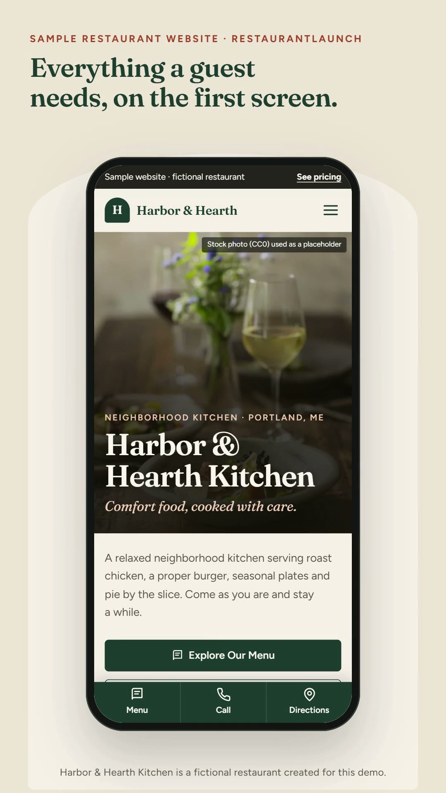
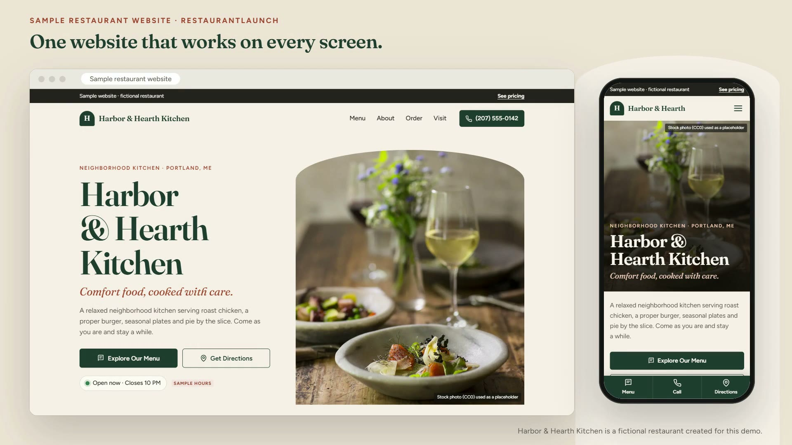

# RestaurantLaunch — Restaurant Website Demo & Client Kit

A polished, mobile-first website for a **fictional** neighborhood restaurant, **Harbor & Hearth Kitchen**. You can show it to restaurant owners, then reuse it as the starting point for each paying client.

Everything about the restaurant (name, colors, menu, hours, address, links, photos) lives in **one file: [`site/config.js`](site/config.js)**. Change that file and the whole site updates. There's no build step, no database and no paid services.

> Harbor & Hearth Kitchen is not a real business. Its menu, prices, hours, address and phone number are sample content, and the site labels them that way. The photos are CC0 stock images (see [image credits](docs/image-credits.md)).

---

## What's in this repository

| Folder / file | What it is |
| --- | --- |
| [`site/`](site/) | **The website.** This is the only folder that gets published. |
| [`site/config.js`](site/config.js) | ⭐ The restaurant configuration: the file you edit for each client. |
| [`site/agency.config.js`](site/agency.config.js) | Your RestaurantLaunch packages and prices (shown only on the demo). |
| [`site/js/components/`](site/js/components/) | Reusable sections: navigation, hero, menu, about, opening hours, ordering, contact, footer… |
| [`site/css/styles.css`](site/css/styles.css) | All styles, mobile-first. |
| [`videos/`](videos/) | Ready-to-share demo videos (vertical for phones, landscape for laptops). |
| [`docs/`](docs/) | Deployment, customization and sales guides (listed below). |
| [`tools/`](tools/) | Optional desktop tools: local preview server, automated tests, video recorder. |
| [`render.yaml`](render.yaml) | Optional one-click Render setup (Blueprint). |

```
site/
├── index.html              ← page skeleton + <head> tags (title, description, link previews)
├── config.js               ← ⭐ restaurant content and settings
├── agency.config.js        ← RestaurantLaunch packages (demo only)
├── favicon.svg
├── css/styles.css
├── images/                 ← hero-1600.webp, hero-900.webp, about-dining.webp, dish-*.webp, og-image.jpg
└── js/
    ├── core.js             ← shared helpers (safe HTML, links, prices, icons)
    ├── main.js             ← applies config, renders components, wires interactions
    └── components/
        ├── demo-bar.js        ├── about.js           ├── footer.js
        ├── navigation.js      ├── order.js           ├── packages.js
        ├── hero.js            ├── contact.js         └── mobile-actions.js
        ├── menu.js            └── opening-hours.js
```

## Demo videos

| Phone walkthrough · vertical · 1:06 | Desktop + phone · landscape · 0:45 |
| --- | --- |
| [](videos/harbor-hearth-phone-demo.mp4) | [](videos/harbor-hearth-desktop-demo.mp4) |

Tap a picture to open the video. How to share them is in [videos/README.md](videos/README.md).

## Guides

1. [Preview, deploy and test, all from your phone](docs/01-preview-and-deploy-from-your-phone.md)
2. [Connect a client-owned domain](docs/02-connect-a-client-domain.md)
3. [Customize the template for a paying restaurant](docs/03-customize-for-a-client.md)
4. [Demo walkthrough script (what to say while showing the site)](docs/04-demo-walkthrough-script.md)
5. [Cold-call script and objection responses](docs/05-cold-call-script.md)
6. [Follow-up email](docs/06-follow-up-email.md)
7. [Client onboarding checklist](docs/07-client-onboarding-checklist.md)
8. [Plan for your first paying client in 30 days](docs/08-first-client-30-day-plan.md)
9. [Test report: what was checked, and what still needs a real phone](docs/09-test-report.md)

## Quick start (phone only)

1. **Publish the demo:** sign in to [render.com](https://render.com) with GitHub → **New → Static Site** → pick this repository → set **Publish directory** to `site` → **Create Static Site**. Full steps are in [guide 1](docs/01-preview-and-deploy-from-your-phone.md).
2. **Open the link Render gives you** (it ends in `.onrender.com`) on your phone. That's your live demo.
3. **Edit content:** on github.com, open `site/config.js` → ✏️ **Edit** → change text → **Commit changes**. Render republishes automatically in a minute or two.

## Features

- **Hero:** name, tagline, photo, "Explore Our Menu" and "Get Directions" buttons, and a live **Open now / Closed** indicator calculated in the restaurant's own time zone.
- **Menu:** categories, descriptions, prices and dietary tags, with touch-friendly category filters.
- **About:** story, highlights and a swipeable photo gallery.
- **Order & reserve:** buttons that link out to the restaurant's existing ordering, reservation and delivery pages. Unconfigured links show as clearly labelled demo buttons; on a client site they're hidden.
- **Visit:** address, click-to-call, Google Maps directions and a weekly hours table with today highlighted.
- **Phone extras:** sticky header, accessible menu toggle, and a bottom bar with **Menu · Call · Directions**.
- **Demo mode:** a single switch (`demoMode` in `config.js`) adds or removes every "sample" label, the demo banner and the pricing section.
- **Quality:** semantic HTML, keyboard support, skip link, visible focus, reduced-motion support, compressed, lazy-loaded WebP images (about 300 KB of photos per phone visit), basic SEO tags, and Restaurant structured data on client sites.

## Run it on a computer (optional)

```bash
node tools/serve.mjs          # then open http://localhost:8080
```

Or simply double-click `site/index.html`. The site uses plain scripts, so it also works when opened directly as a file.

Automated checks (needs Google Chrome installed):

```bash
cd tools
npm install
npm test                      # 76 checks: layout, links, accessibility, interactions, hours logic
npm run videos                # re-records the demo videos (needs ffmpeg)
```

## Ground rules this kit follows

- No fabricated testimonials, client logos, results or "best in town" claims.
- No promise that a website increases revenue or Google rankings.
- Only owner-approved content, links and photos go on a client's site.
- No API keys or secrets in the code.
